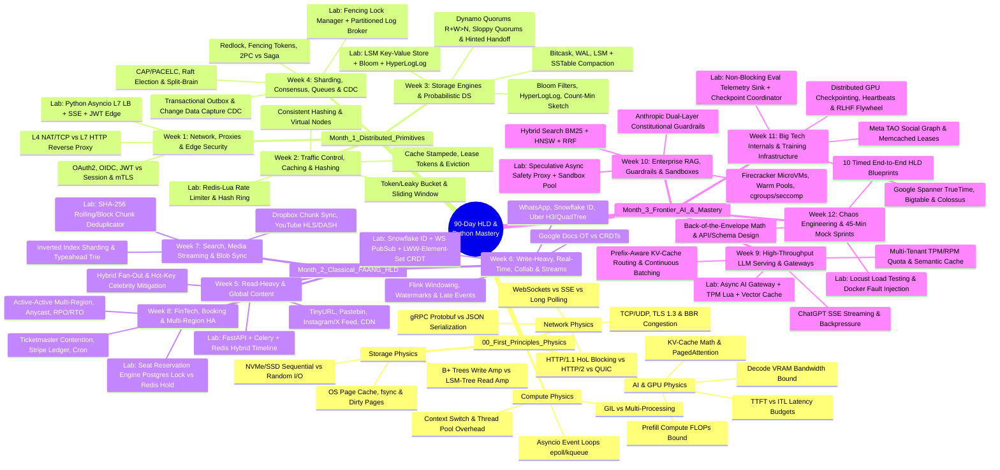

# 🚀 90-Day First-Principles HLD & Python Implementation Course
> **Target:** Google, Meta, Microsoft, OpenAI, Anthropic (Senior / Staff Level)  
> **Approach:** Derive from hardware/network physics → Implement core primitives in Python → Scale & Break with `locust`.

---

## 🧠 Interactive Visual Mind Map (Mermaid)



---

## 🌳 Master Architecture Mind Map (Detailed ASCII Tree)

```text
90-DAY HLD & PYTHON IMPLEMENTATION ROADMAP (COMPLETE EDITION)
│
├── 🧠 00. FIRST-PRINCIPLES HARDWARE, NETWORK & GPU PHYSICS
│   ├── Compute Physics
│   │   ├── CPU Caches (L1/L2/L3), Context Switches, Syscall Overhead, Thread Pool Starvation
│   │   └── Python Concurrency: GIL internals, multiprocessing (CPU) vs asyncio/uvloop epoll (I/O)
│   ├── Network Physics
│   │   ├── TCP 3-Way Handshake, TLS 1.3, TCP Head-of-Line Blocking, BBR Congestion Control
│   │   ├── HTTP/1.1 Keep-Alive vs HTTP/2 Multiplexing vs HTTP/3 (QUIC over UDP)
│   │   └── Payload & Streaming: JSON vs Protobuf (gRPC), WebSockets, Server-Sent Events (SSE)
│   ├── Storage Physics
│   │   ├── OS Page Cache, fsync() durability, Random vs Sequential I/O on NVMe SSDs
│   │   └── B+ Trees (In-Place Page Updates / Write Amp) vs LSM-Trees (Append-Only / Read Amp)
│   └── AI & GPU Physics (OpenAI / Anthropic Core)
│       ├── Compute vs Memory Roofline: Prefill Phase (Compute-bound) vs Decode Phase (VRAM BW-bound)
│       ├── KV-Cache Memory Math: FP16/FP8 precision footprint, PagedAttention (vLLM), Prefix Caching
│       └── Core SLIs: Time-To-First-Token (TTFT), Inter-Token Latency (ITL), Tokens Per Second (TPS)
│
├── 🛠️ MONTH 1: DISTRIBUTED PRIMITIVES FROM SCRATCH (Weeks 1–4)
│   ├── Week 01: Networking, Reverse Proxies & Edge Security
│   │   ├── Theory   : OSI layers, L4 (VIP/NAT/TCP) vs L7 (HTTP/URL/Header) Load Balancing
│   │   ├── Algorithms: Round-Robin, Weighted RR, Least Connections, Power-of-Two-Choices
│   │   ├── Security : OAuth2, OIDC, Stateless JWT vs Stateful Opaque Tokens, Token Revocation, mTLS Service Mesh
│   │   └── 💻 Code  : `/month-1-primitives/week-01-l7-load-balancer/`
│   │                  └─ Asyncio + aiohttp L7 Reverse Proxy with Active Health Checks, SSE Passthrough & JWT Edge Auth
│   │
│   ├── Week 02: Traffic Control, Caching & Consistent Hashing
│   │   ├── Theory   : Rate Limiting (Token Bucket, Leaky Bucket, Fixed Window, Sliding Window Log/Counter)
│   │   ├── Caching  : Write-Through, Write-Around, Write-Back; Eviction (LRU, LFU, W-TinyLFU)
│   │   ├── Failure  : Cache Stampede (Thundering Herd), Singleflight Request Coalescing, Meta Lease Tokens
│   │   ├── Topology : Consistent Hashing Ring, Virtual Nodes, Bounded-Load Consistent Hashing
│   │   └── 💻 Code  : `/month-1-primitives/week-02-rate-limiter-consistent-hash/`
│   │                  ├─ 1. Atomic Distributed Sliding-Window & Token Bucket Rate Limiter (`redis-py` + Lua)
│   │                  └─ 2. Consistent Hash Ring (`bisect` + Virtual Nodes + Key Migration Analyzer)
│   │
│   ├── Week 03: Storage Engines, Replication & Probabilistic Data Structures
│   │   ├── Storage  : Write-Ahead Log (WAL), Bitcask (In-Memory KeyDir), LSM-Tree (MemTable + SSTables + Size/Leveled Compaction)
│   │   ├── Prob DS  : Bloom Filters (False Positive math), HyperLogLog (Unique Cardinality), Count-Min Sketch (Top-K Frequency)
│   │   ├── Replicas : Single-Leader, Multi-Leader, Leaderless (Dynamo-style Quorum R + W > N, Sloppy Quorums, Hinted Handoff)
│   │   ├── Conflicts: Read Repair, Merkle Trees (Anti-Entropy), Vector Clocks vs Last-Write-Wins (LWW)
│   │   └── 💻 Code  : `/month-1-primitives/week-03-lsm-kv-store/`
│   │                  ├─ 1. Append-Only Bitcask/LSM Storage Engine with WAL & Background Compaction
│   │                  └─ 2. Custom Binary `mmh3` Bloom Filter & HyperLogLog Estimator
│   │
│   └── Week 04: Sharding, Consensus, Queues & Change Data Capture (CDC)
│       ├── Theory   : CAP & PACELC Theorems, Linearizability vs Sequential vs Eventual Consistency
│       ├── Consensus: Raft Leader Election, Log Replication, Split-Brain, Quorum Leases
│       ├── Locking  : Distributed Locks (Redlock critique), Monotonic Fencing Tokens, ZooKeeper/etcd Ephemeral Nodes
│       ├── Txns     : Two-Phase Commit (2PC) blocking bottleneck vs Saga Pattern (Orchestration vs Choreography)
│       ├── Streaming: Message Queues (AMQP) vs Partitioned Append Logs (Kafka), Consumer Groups, DLQs, Idempotency
│       ├── Data Sync: Transactional Outbox Pattern & Change Data Capture (CDC / Postgres WAL tailing)
│       └── 💻 Code  : `/month-1-primitives/week-04-locks-and-broker/`
│                      ├─ 1. Distributed Lock Manager with Fencing Token Validation & Idempotency Middleware
│                      └─ 2. File-Backed Partitioned Log Broker with Consumer Offsets & Outbox Relay
│
├── 🌍 MONTH 2: CLASSICAL FAANG ARCHITECTURES (Weeks 5–8)
│   ├── Week 05: Read-Heavy Systems & Global Content Delivery
│   │   ├── Concepts : Read-to-Write Ratios (1000:1), Multi-Tier Caching (Browser -> CDN -> Edge -> Redis -> DB)
│   │   ├── Patterns : Fan-Out on Write (Push) vs Fan-Out on Read (Pull) vs Hybrid (Celebrity/Hot-Key problem)
│   │   ├── Pagination: Offset vs Keyset/Cursor Pagination at scale
│   │   ├── Systems  : 1. URL Shortener (Base62 vs KGS)  2. Pastebin  3. Instagram/X News Feed  4. Global CDN (Anycast)
│   │   └── 💻 Code  : `/month-2-faang-systems/week-05-hybrid-fanout-feed/`
│   │                  └─ FastAPI + Celery + Redis + Postgres Hybrid Timeline Service with Hot-User Read Merge
│   │
│   ├── Week 06: Write-Heavy, Real-Time, Collaborative Editing & Stream Processing
│   │   ├── Stateful : WebSocket Connection Gateways, Presence Heartbeat Storms, Connection Draining
│   │   ├── Ordering : 64-bit Snowflake IDs, Lamport Timestamps, Hybrid Logical Clocks (HLC)
│   │   ├── Collab   : Real-Time Document Sync (Google Docs / Notion) — Operational Transformation (OT) vs CRDTs (LWW-Set, RGA)
│   │   ├── Spatial  : Geohashing vs QuadTrees vs Uber H3 Hexagonal Hierarchical Index
│   │   ├── Streams  : Flink-style Stream Processing, Tumbling/Sliding/Session Windows, Watermarks, Late-Arriving Events
│   │   ├── Systems  : 1. WhatsApp/Slack  2. Google Docs  3. Uber Location & Dispatch  4. Datadog Metrics / Ad Click Aggregator
│   │   └── 💻 Code  : `/month-2-faang-systems/week-06-realtime-chat-snowflake/`
│   │                  ├─ 1. Bitwise 64-Bit Snowflake ID Generator & Tumbling Window Event Aggregator
│   │                  └─ 2. Multi-Node FastAPI WebSocket Chat & CRDT Collaborative State Sync via Redis Pub/Sub
│   │
│   ├── Week 07: Search, Media Streaming & Large-Scale Blob Storage
│   │   ├── Blob Sync: Client-side Content-Defined Chunking (Rabin Fingerprinting / Rolling Hash), SHA-256 Deduplication, Presigned URLs
│   │   ├── Video    : Transcoding DAG Pipelines, Adaptive Bitrate Streaming (HLS / DASH), Gop/Chunk Segmenting
│   │   ├── Search   : Inverted Index Sharding (Document-Partitioned vs Term-Partitioned), Trie / Prefix Trees for Typeahead
│   │   ├── Crawling : Politeness (`robots.txt`), URL Frontier Priority Queues, SimHash Near-Duplicate Detection
│   │   ├── Systems  : 1. Dropbox / Google Drive  2. YouTube / Netflix  3. Search Typeahead Autocomplete  4. Distributed Web Crawler
│   │   └── 💻 Code  : `/month-2-faang-systems/week-07-chunked-file-sync/`
│   │                  └─ Content-Addressable Chunked File Sync Engine (Python Client + FastAPI + MinIO S3 + Delta Sync)
│   │
│   └── Week 08: High-Contention Transactional, FinTech & Multi-Region HA
│       ├── Concurrency: ACID Isolation Levels (Read Committed, Repeatable Read, Snapshot Isolation, Serializable)
│       ├── Locking  : Pessimistic (`SELECT FOR UPDATE NOWAIT/SKIP LOCKED`) vs Optimistic Concurrency Control (Version column)
│       ├── FinTech  : Double-Entry Immutable Accounting Ledger, Webhook Delivery with Exponential Backoff + Jitter + HMAC Signatures
│       ├── Multi-Region: Active-Active vs Active-Passive Disaster Recovery, RPO vs RTO math, BGP Anycast, Split-Brain Resolution
│       ├── Systems  : 1. Ticketmaster / Flash Sale  2. Stripe Payment & Ledger  3. Distributed Job Scheduler  4. Multi-Region Active-Active DB
│       └── 💻 Code  : `/month-2-faang-systems/week-08-ticket-booking-engine/`
│                      └─ High-Contention Seat Booking Engine (Benchmarking Postgres Row Locks vs Redis Lua Virtual Waiting Queue + TTL Hold)
│
└── 🤖 MONTH 3: FRONTIER AI INFRASTRUCTURE & INTERVIEW MASTERY (Weeks 9–12)
    ├── Week 09: High-Throughput LLM Serving, AI Gateways & GPU Clusters
    │   ├── Quotas   : Token-aware Rate Limiting — Requests Per Minute (RPM) vs Tokens Per Minute (TPM) with Pre-estimation + Reconciliation
    │   ├── Caching  : Exact Prefix Caching vs Semantic Vector Caching (Embedding Cosine Similarity Thresholds & False-Positive Risk)
    │   ├── Routing  : KV-Cache Prefix-Aware Load Balancing (routing multi-turn chats to the GPU node holding the cached KV blocks)
    │   ├── Serving  : Continuous Iteration-Level Batching, Speculative Decoding, Disaggregated Prefill & Decode Clusters
    │   ├── Systems  : 1. ChatGPT / Claude Real-Time Streaming Backend  2. Multi-Tenant Enterprise AI Gateway  3. Batch Inference Queue
    │   └── 💻 Code  : `/month-3-frontier-ai/week-09-ai-gateway-semantic-cache/`
    │                  └─ Async SSE AI Gateway with Atomic Redis-Lua TPM/RPM Limiter, Semantic Cache & Backpressure Control
    │
    ├── Week 10: Enterprise RAG, Vector Search, Constitutional Guardrails & Code Sandboxes
    │   ├── Vectors  : Flat vs IVF-PQ (Product Quantization) vs HNSW (Hierarchical Navigable Small World) memory/recall trade-offs
    │   ├── RAG      : Hybrid Search (Sparse BM25/SPLADE + Dense Embeddings + Reciprocal Rank Fusion RRF + Cross-Encoder Reranking)
    │   ├── Safety   : Anthropic-style Dual-Layer Constitutional Guardrails — Sync Input Gate + Speculative Async Streaming Output Classifier
    │   ├── Sandboxes: Untrusted LLM Code Execution (Code Interpreter / Artifacts) — Why Docker fails, Firecracker MicroVMs, Warm Pool Snapshots, OverlayFS, `cgroups`/`seccomp`, Network Egress Whitelisting
    │   ├── Systems  : 1. Multi-Tenant Enterprise RAG  2. Real-Time Streaming Guardrail System  3. Cloud Agent Sandbox / Code Interpreter
    │   └── 💻 Code  : `/month-3-frontier-ai/week-10-speculative-guardrail-proxy/`
    │                  └─ Speculative Streaming Guardrail Proxy (Ring-buffered SSE token streamer + Concurrent Safety Classifier + Warm Pool Sandbox Manager)
    │
    ├── Week 11: Big Tech Foundational Papers & Distributed Training Infrastructure
    │   ├── Google   : GFS/Colossus, Bigtable (Tablet Server + Chubby + SSTables), Spanner (TrueTime API `[earliest, latest]` GPS/Atomic Clocks)
    │   ├── Meta     : TAO (Objects & Associations Graph Cache), Memcached Scaling (Mcrouter, Lease Tokens, Gutter Pools)
    │   ├── AI Infra : Fault-Tolerant Distributed GPU Training — 3D Parallelism (DP/TP/PP), AllReduce, Async Checkpointing to S3/NVMe, Heartbeat & Elastic Worker Replacement
    │   ├── Flywheel : High-Throughput LLM Telemetry, Online A/B Eval, Human Preference (RLHF/DPO) Data Pipeline
    │   └── 💻 Code  : `/month-3-frontier-ai/week-11-async-eval-telemetry/`
    │                  └─ Non-Blocking Async Telemetry Collector, Batched MinIO/S3 Trace Sink & Elastic Worker Heartbeat Coordinator
    │
    └── Week 12: Chaos Engineering, Performance Benchmarking & 45-Minute Interview Sprints
        ├── Framework: The 45-Minute Derivation Rubric (1. Functional/Non-Functional -> 2. Back-of-Envelope Math -> 3. API & Data Model -> 4. High-Level Topology -> 5. Deep-Dive Bottlenecks & Failure Modes)
        ├── Chaos Lab: Fault Injection — Killing Redis/DB nodes, injecting 500ms network latency, simulating hot-key stampedes & slow SSE consumers
        ├── Mocks    : 5 Classical FAANG Mocks + 5 Frontier AI Infrastructure Mocks
        └── 💻 Code  : `/month-3-frontier-ai/week-12-chaos-benchmarks/`
                       └─ Complete `locust` Load Testing Suite + Automated Docker Chaos Fault Injection Scripts
```

---

## 📅 Granular Week-by-Week & Day-by-Day Execution Checklist

### 🧠 Module 00: First-Principles Foundation (Pre-Flight)
- [ ] **00.1 Hardware & Latency Numbers:** Memorize L1/L2/RAM/NVMe/Network/Cross-Region latency numbers and throughput bounds.
- [ ] **00.2 Back-of-the-Envelope Math:** Master QPS, Peak QPS ($2\times$–$3\times$), Storage (5-year retention), RAM/Cache ($20\%$ rule), and GPU VRAM/KV-Cache formulas.
- [ ] **00.3 Local Sandbox Setup:** Initialize `docker-compose.yml` (PostgreSQL, Redis, Kafka, MinIO, Qdrant, Prometheus) and Python `uv` / `pyproject.toml`.

---

### 🛠️ Month 1: Distributed Primitives from Scratch

#### Week 1: Networking, Reverse Proxies & Edge Security
- [ ] **Day 1 (Theory):** OSI model in practice, TCP 3-way handshake, TLS 1.3 overhead, TCP Head-of-Line (HoL) blocking, HTTP/1.1 vs HTTP/2 multiplexing vs HTTP/3 (QUIC).
- [ ] **Day 2 (Theory):** L4 (TCP/UDP NAT) vs L7 (HTTP) Load Balancers; Round-Robin, Least Connections, Power-of-Two-Choices; Edge Security (OAuth2, OIDC, Stateless JWT vs Stateful Session, mTLS).
- [ ] **Day 3 (Code):** Build an `asyncio` + `aiohttp` L7 Reverse Proxy with upstream connection pooling and configurable routing algorithms.
- [ ] **Day 4 (Code):** Add active background health-check probes, passive circuit breaking, JWT signature verification middleware, and Server-Sent Events (SSE) streaming support.
- [ ] **Day 5 (Break It):** Spawn 3 backend FastAPI servers, run `locust` with 1,000 concurrent users, kill 1 backend node mid-flight, and verify zero dropped requests.
- [ ] **Days 6–7 (HLD Drills):** Design an Enterprise API Gateway & Global L4/L7 Load Balancing Tier.

#### Week 2: Traffic Control, Caching & Consistent Hashing
- [ ] **Day 1 (Theory):** Rate limiting algorithms (Token Bucket, Leaky Bucket, Fixed Window, Sliding Window Log vs Counter) and distributed race conditions.
- [ ] **Day 2 (Theory):** Cache topologies (Write-Through, Write-Around, Write-Back), Eviction (LRU/LFU), Cache Stampede (Singleflight & Meta Lease Tokens), and Consistent Hashing with Virtual Nodes.
- [ ] **Day 3 (Code):** Implement atomic Token Bucket and Sliding Window Rate Limiters in FastAPI using `redis-py` and custom Lua scripts.
- [ ] **Day 4 (Code):** Implement a Consistent Hash Ring in pure Python (`bisect`, SHA-256) with configurable virtual nodes and a Singleflight Stampede lock.
- [ ] **Day 5 (Break It):** Simulate a hot-key cache expiration under 2,000 RPS and prove your Singleflight lock prevents database collapse.
- [ ] **Days 6–7 (HLD Drills):** Design a Distributed Rate Limiter (Cloudflare/Stripe scale) & Design a Distributed In-Memory Cache (Memcached/Redis Cluster).

#### Week 3: Storage Engines, Replication & Probabilistic Data Structures
- [ ] **Day 1 (Theory):** Storage physics: Write-Ahead Log (WAL), Bitcask (Hash Index), LSM-Trees + SSTables + Size/Leveled Compaction vs B+ Trees (Page splits, Write vs Read amplification).
- [ ] **Day 2 (Theory):** Probabilistic Data Structures (Bloom Filters, HyperLogLog, Count-Min Sketch) & Replication (Single-Leader, Multi-Leader, Dynamo Leaderless $R + W > N$, Sloppy Quorums, Hinted Handoff, Vector Clocks).
- [ ] **Day 3 (Code):** Build a persistent Bitcask/LSM Key-Value engine in Python with an append-only disk log, in-memory offset map, and background log compaction.
- [ ] **Day 4 (Code):** Implement a bit-array Bloom Filter (`mmh3`) to skip disk lookups for non-existent keys, plus a HyperLogLog unique counter.
- [ ] **Day 5 (Break It):** Benchmark sequential write throughput vs random read latency before and after compaction and Bloom filter integration.
- [ ] **Days 6–7 (HLD Drills):** Design a Dynamo-style Key-Value Store & Design a Real-Time Unique Visitor & Top-K Trending System.

#### Week 4: Sharding, Consensus, Queues & Change Data Capture (CDC)
- [ ] **Day 1 (Theory):** CAP & PACELC theorems, Linearizability vs Eventual Consistency, Raft Consensus (Leader Election, Log Replication, Split-Brain), and Distributed Locks with Fencing Tokens.
- [ ] **Day 2 (Theory):** Distributed Transactions (2PC vs Saga Orchestration/Choreography), Transactional Outbox Pattern, Change Data Capture (CDC), and Kafka Partitioned Log internals.
- [ ] **Day 3 (Code):** Build a Distributed Lock Manager with monotonic Fencing Tokens and an Idempotency Key middleware for safe retries.
- [ ] **Day 4 (Code):** Build a file-backed Partitioned Log Broker supporting Partition Keys, Consumer Groups, Offset commits, and an Outbox Relay worker.
- [ ] **Day 5 (Break It):** Simulate a paused process holding an expired lock (GC pause simulation) and prove the storage layer rejects the stale Fencing Token.
- [ ] **Days 6–7 (HLD Drills):** Design a Distributed Lock Service (Chubby/etcd) & Design a High-Throughput Distributed Message Queue (Kafka).

---

### 🌍 Month 2: Classical FAANG Systems

#### Week 5: Read-Heavy & Global Content Delivery
- [ ] **Day 1 (Theory):** Read-heavy scaling patterns, Multi-tier CDN/Edge caching, Cursor/Keyset pagination vs Offset pagination, and the Fan-Out on Write vs Fan-Out on Read trade-off.
- [ ] **Day 2 (Theory):** Mitigating hot keys/celebrity shards, Base62 vs Pre-generated Key Generation Service (KGS), and social graph caching (Meta TAO mental model).
- [ ] **Day 3 (Code):** Build the write path and async Celery fan-out pipeline for a Social News Feed (pushing post IDs to followers' Redis ZSET timelines).
- [ ] **Day 4 (Code):** Implement the Hybrid Fan-Out read path: fast O(1) timeline fetch for regular users merged at read-time with high-follower (>100k) celebrity posts.
- [ ] **Day 5 (Break It):** Benchmark feed generation latency when a celebrity with 1M followers posts under pure push vs hybrid fan-out.
- [ ] **Days 6–7 (HLD Drills):** 1. TinyURL / Pastebin  2. Instagram / X News Feed  3. Global Content Delivery Network (CDN).

#### Week 6: Write-Heavy, Real-Time, Collaborative Editing & Stream Processing
- [ ] **Day 1 (Theory):** Stateful WebSocket clusters, L7 WS routing, Presence heartbeat batching, and time-ordered ID generation (64-bit Snowflake, Lamport Clocks).
- [ ] **Day 2 (Theory):** Real-time Collaborative Editing (Operational Transformation vs CRDTs); Geospatial Indexing (QuadTrees vs Uber H3); Stream Processing (Tumbling/Sliding Windows, Watermarks, Late Events).
- [ ] **Day 3 (Code):** Implement a thread/async-safe 64-bit Snowflake ID generator and a multi-node FastAPI WebSocket chat cluster bridged via Redis Pub/Sub.
- [ ] **Day 4 (Code):** Implement a Conflict-Free Replicated Data Type (LWW-Element-Set / State CRDT) and a Tumbling Window stream aggregator in Python.
- [ ] **Day 5 (Break It):** Simulate concurrent out-of-order edits across 2 disconnected WebSocket nodes and verify deterministic CRDT convergence upon reconnection.
- [ ] **Days 6–7 (HLD Drills):** 1. WhatsApp / Slack  2. Google Docs / Notion Collaborative Editor  3. Uber Real-Time Location & Dispatch  4. Datadog Metrics / Ad-Click Stream Aggregator.

#### Week 7: Search, Media Streaming & Large-Scale Blob Storage
- [ ] **Day 1 (Theory):** Large file synchronization: Content-Defined Chunking (Rolling Hash), SHA-256 Content-Addressable Storage, Multipart Presigned URLs, and Metadata vs Blob separation.
- [ ] **Day 2 (Theory):** Video transcoding DAGs & Adaptive Bitrate Streaming (HLS/DASH); Inverted Index partitioning (Document vs Term sharding); Distributed Web Crawler architecture.
- [ ] **Day 3 (Code):** Build a Dropbox-style Chunked File Sync client & FastAPI server that splits large files into content-addressed chunks and uploads only missing hashes to MinIO (S3).
- [ ] **Day 4 (Code):** Add delta-sync verification, metadata versioning in PostgreSQL, and real-time folder change notifications.
- [ ] **Day 5 (Break It):** Modify 50KB inside a 100MB binary file and verify that network transfer is limited solely to the modified chunk (<1% bandwidth).
- [ ] **Days 6–7 (HLD Drills):** 1. Google Drive / Dropbox  2. YouTube / Netflix Video Streaming  3. Search Typeahead Autocomplete  4. Distributed Web Crawler.

#### Week 8: High-Contention Transactional, FinTech & Multi-Region HA
- [ ] **Day 1 (Theory):** Database Isolation Levels, Pessimistic Locking (`SELECT FOR UPDATE SKIP LOCKED`), Optimistic Concurrency Control, and Double-Entry Immutable Ledgers.
- [ ] **Day 2 (Theory):** Multi-Region High Availability: Active-Active vs Active-Passive, RPO/RTO calculations, Anycast DNS failover, Cross-Region replication conflicts, and Webhook delivery guarantees.
- [ ] **Day 3 (Code):** Build a Ticketmaster Seat Booking Engine implementing Strategy A (PostgreSQL Pessimistic Row Locking) and Strategy B (Redis Atomic Lua Hold + TTL + Virtual Waiting Queue).
- [ ] **Day 4 (Code):** Build an Idempotent Payment & Double-Entry Ledger service with a reliable Webhook dispatcher (Exponential Backoff + Full Jitter + HMAC-SHA256 signatures).
- [ ] **Day 5 (Break It):** Fire 5,000 concurrent booking requests for the exact same seat using `locust`; verify 1 winner, 4,999 clean rejections, and zero double-bookings.
- [ ] **Days 6–7 (HLD Drills):** 1. Ticketmaster / Flash Sale  2. Stripe Payment Gateway & Ledger  3. Distributed Job Scheduler  4. Multi-Region Active-Active Architecture.

---

### 🤖 Month 3: Frontier AI Infrastructure (OpenAI / Anthropic) & Mastery

#### Week 9: High-Throughput LLM Serving, AI Gateways & GPU Clusters
- [ ] **Day 1 (Theory):** GPU Inference Physics: Prefill vs Decode, KV-Cache VRAM math, PagedAttention (vLLM), Continuous Iteration-Level Batching, and Disaggregated Serving.
- [ ] **Day 2 (Theory):** AI Gateway design: Token-based Rate Limiting (RPM + TPM with pre-flight estimation & post-stream reconciliation), Semantic Caching, and Prefix-Aware KV-Cache Routing.
- [ ] **Day 3 (Code):** Build an async SSE Streaming AI Gateway in Python with an atomic Redis-Lua dual RPM/TPM rate limiter and client disconnect cancellation propagation.
- [ ] **Day 4 (Code):** Add a Semantic Cache layer (Embedding generation + Qdrant/FAISS cosine similarity lookup) and a Prefix-Hash Sticky Router to maximize simulated KV-Cache hits.
- [ ] **Day 5 (Break It):** Simulate slow-reading mobile clients (SSE backpressure) and token quota exhaustion mid-stream; verify bounded memory usage in the gateway.
- [ ] **Days 6–7 (HLD Drills):** 1. ChatGPT / Claude Real-Time Streaming Architecture  2. Multi-Tenant Enterprise AI API Gateway  3. Large-Scale Batch Inference & Prompt Caching System.

#### Week 10: Enterprise RAG, Vector Search, Constitutional Guardrails & Code Sandboxes
- [ ] **Day 1 (Theory):** Vector Indexing at scale (Flat vs IVF-PQ vs HNSW memory/recall math); Hybrid RAG (BM25 + Dense Vector + Reciprocal Rank Fusion + Cross-Encoder Reranking).
- [ ] **Day 2 (Theory):** Anthropic Dual-Layer Constitutional Guardrails (Sync Input Filter + Speculative Async Output Stream Moderation) & Untrusted Code Execution Sandboxes (Firecracker MicroVMs, Warm Pools, OverlayFS, `cgroups`/`seccomp`).
- [ ] **Day 3 (Code):** Build a Speculative Streaming Guardrail Proxy that streams tokens to the user with minimal latency using a sliding lookahead window while running concurrent async safety evaluations.
- [ ] **Day 4 (Code):** Build a Hybrid Search RRF retriever and a Pre-Warmed Sandbox Pool Manager (using isolated Python subprocesses/containers with strict timeout and memory limits).
- [ ] **Day 5 (Break It):** Inject a policy-violating token sequence mid-stream and verify the proxy halts the SSE stream within <50ms before the unsafe chunk flushes to the client.
- [ ] **Days 6–7 (HLD Drills):** 1. Multi-Tenant Enterprise RAG Pipeline  2. Anthropic Real-Time Constitutional Guardrail System  3. OpenAI Code Interpreter / Claude Artifacts MicroVM Sandbox.

#### Week 11: Big Tech Foundational Papers & Distributed Training Infrastructure
- [ ] **Day 1 (Theory):** Google Internals: GFS/Colossus, Bigtable (Single-Master + Tablet Servers + Chubby + SSTables), and Spanner (TrueTime `[earliest, latest]` uncertainty window & External Consistency).
- [ ] **Day 2 (Theory):** Meta TAO & Memcached Leases; AI Training Infrastructure: 3D Parallelism, AllReduce bottlenecks, High-Throughput Async Checkpointing to Object Storage, Heartbeat Failure Detection, and Elastic Node Recovery.
- [ ] **Day 3 (Code):** Build a Non-Blocking Async LLM Telemetry & Eval Collector that buffers high-throughput prompt/completion traces in memory and flushes compressed parquet/JSONL batches to MinIO (S3).
- [ ] **Day 4 (Code):** Build a Distributed Training Checkpoint & Elastic Worker Coordinator (heartbeat tracking, stale worker eviction, and state resumption from latest checkpoint manifest).
- [ ] **Day 5 (Break It):** Kill a simulated training worker mid-epoch and verify the coordinator reassigns the shard and resumes from the last committed MinIO checkpoint within 2 seconds.
- [ ] **Days 6–7 (HLD Drills):** 1. Google Spanner / Bigtable  2. Meta TAO Social Graph  3. Fault-Tolerant Distributed GPU Training Cluster  4. RLHF / Automated Evaluation Data Flywheel.

#### Week 12: Chaos Engineering & 45-Minute Interview Mock Sprints
- [ ] **Day 1–2 (Chaos Lab):** Write a unified `locust` benchmark and Docker chaos script that injects network latency, kills Redis/DB containers, and tests graceful fallback across your Month 1–3 builds.
- [ ] **Day 3 (Mock Sprint 1):** Timed 45-min Mocks — *Design Uber* & *Design ChatGPT Streaming Backend*.
- [ ] **Day 4 (Mock Sprint 2):** Timed 45-min Mocks — *Design Google Docs (CRDT)* & *Design Multi-Tenant LLM Gateway with Semantic Cache*.
- [ ] **Day 5 (Mock Sprint 3):** Timed 45-min Mocks — *Design Ticketmaster* & *Design Code Interpreter MicroVM Sandbox*.
- [ ] **Day 6 (Mock Sprint 4):** Timed 45-min Mocks — *Design Instagram/X Feed* & *Design Enterprise RAG + Real-Time Ingestion*.
- [ ] **Day 7 (Mock Sprint 5):** Timed 45-min Mocks — *Design WhatsApp* & *Design Anthropic Constitutional Guardrail & Eval Flywheel*.